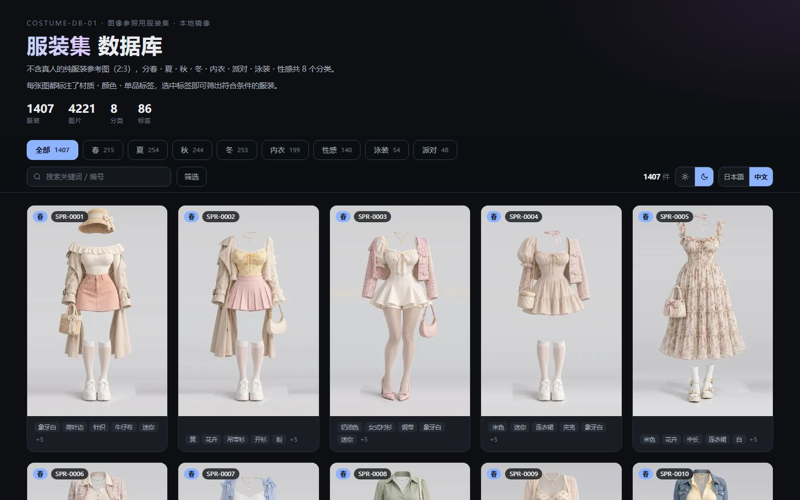
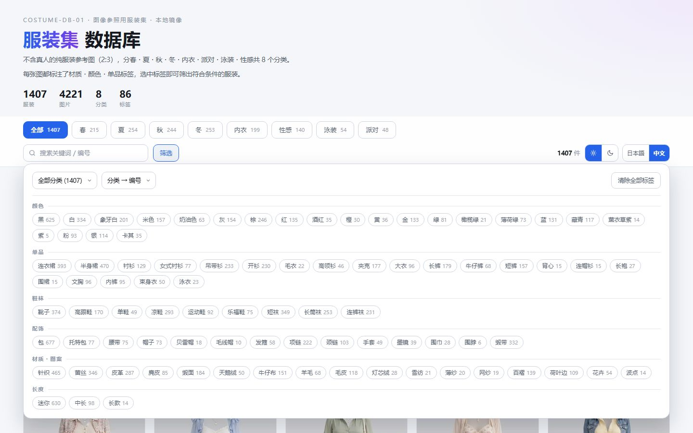

# AI Costume Gallery · 中文版

**1407 件服装 / 4221 张参考图，8 个分类 + 86 个标签分面筛选**

零依赖静态画廊 · 双主题 · 中日双语 · 双击即开

[中文](#中文) · [日本語](#日本語) · [English](#english)

> ⚠️ **图片素材著作权归原作者 ギア 所有，原站条款禁止再分发。本仓库不含任何图片文件。**
> 详见 [NOTICE.md](NOTICE.md)。

---

# 中文

## 📖 项目简介

> **AI Costume Gallery 中文版**是 [ai-costume-gallery.pages.dev](https://ai-costume-gallery.pages.dev/) 的元数据镜像与汉化项目。
> 原站是一套面向 AI 绘画 / 服装设计的服装参考图库，分类为日文、关键词为英文，不提供批量下载与组合检索。
> 本项目把分类与 86 个标签全部译为中文，并把关键词做成了 6 组分面筛选。

原作者：ギア（[@giaaibusi](https://x.com/giaaibusi)）

## ✨ 核心特性

- 🎯 **完整汉化**：8 个分类 + 86 个标签，标签同时提供日文名，英文原文保留在 `title` 提示中
- 🏷️ **分面筛选**：86 个标签按语义分 6 组 —— 颜色(22) / 单品(21) / 鞋袜(9) / 配饰(14) / 材质・图案(17) / 长度(3)，多选为 AND 逻辑，每枚标签带命中数
- 🔍 **三向搜索**：输入中文、日文或英文原文都能命中
- 🔀 **三种排序**：分类 → 编号（默认）/ 编号 / 标签数
- 🔎 **灯箱**：缩略图 → 中图渐进加载，`←` `→` 前后切换，`Esc` 关闭，触摸可滑动；点击标签可直接追加筛选
- 🌗 **双主题**：浅色 / 深色，CSS 变量驱动，localStorage 记忆，首帧前套用不闪白
- 🌐 **双语切换**：日本語 / 中文实时切换，无需刷新
- 📦 **零依赖**：单个 HTML 文件，数据内嵌，**`file://` 双击即开**，不需要起服务器
- 📊 **数据可复用**：中文记录、元数据、英日⇄中对照表全部导出为 JSON / CSV
- 🔎 **SEO 就绪**：robots.txt / sitemap.xml / 404.html / og-cover / JSON-LD 结构化数据
- 💡 **提示词友好**：标签的英文原文随时可复制，直接用于 AI 出图


## 📸 页面预览

| 暗色 · 列表 | 浅色 · 分面筛选 |
|:---:|:---:|
|  |  |

> 截图中的素材已做模糊处理，仅演示界面结构。

## 📊 数据规模

| 分类 | 编号前缀 | 数量 |
|---|---|---:|
| 春 | SPR | 215 |
| 夏 | SUM | 254 |
| 秋 | AUT | 244 |
| 冬 | WIN | 253 |
| 内衣（ランジェリー） | LNG | 199 |
| 性感（セクシー） | SXY | 140 |
| 泳装（水着） | SWM | 54 |
| 派对（パーティ） | PTY | 48 |
| **合计** | | **1407** |

每件平均 8.5 个标签，每件提供三档图。

### 标签分组

| 组 | 数量 | 示例 |
|---|---:|---|
| 颜色 | 22 | black 黑 / ivory 象牙白 / navy 藏青 / burgundy 酒红 |
| 单品 | 21 | dress 连衣裙 / camisole 吊带衫 / corset 束身衣 |
| 鞋袜 | 9 | boots 靴子 / pumps 单鞋 / tights 连裤袜 |
| 配饰 | 14 | bag 包 / choker 颈链 / beret 贝雷帽 |
| 材质・图案 | 17 | knit 针织 / lace 蕾丝 / polka-dot 波点 |
| 长度 | 3 | mini 迷你 / midi 中长 / maxi 长款 |

## 🛠️ 技术栈

| 技术 | 用途 |
|---|---|
| 原生 HTML / CSS / JS | 无框架、无构建、无 npm 依赖 |
| CSS 自定义属性 | 双主题切换的全部色值 |
| `localStorage` | 主题与语言偏好持久化 |
| Python 3 | 抓取、翻译、构建脚本 |
| Chrome Headless | 生成 og-cover 与预览截图 |

**刻意不使用**：React / Vue、打包工具、CDN、外部字体、任何第三方库。

## 📁 项目结构

```
.
├── index.html              # 单页画廊（数据内嵌，file:// 可直开）
├── robots.txt
├── sitemap.xml
├── 404.html
├── og-cover.jpg            # 1200×630 社交分享封面（自制纯排版）
├── docs/                   # 界面预览截图（素材已模糊）
├── manifest.json           # 全量清单（含原始 URL 与本地路径）
├── manifest.csv            # 同上，Excel 可直接打开
├── data/
│   ├── costume.json        # 原始日文数据（未改动，1407 条）
│   ├── costume-zh.json     # 中文数据（含英/日/中三语标签）
│   ├── meta.json           # 分类与标签分组元数据
│   └── translations.csv    # 英→日→中对照表（94 条）
├── scripts/
│   ├── extract.py          # 从原站存档解析内嵌数据
│   ├── manifest.py         # 生成清单
│   ├── download.py         # 并发下载器（三档、断点续传）
│   ├── translations.py     # 日→中 / 英→中 / 英→日 词典
│   ├── build_gallery.py    # 构建 index.html + data/ + SEO 文件
│   ├── build_dist.sh       # 生成部署目录 dist/
│   └── verify.py           # 校验三档文件完整性
├── thumbs/                 # 缩略图 360×540（gitignored）
├── img/                    # 中图 1366×2048（gitignored）
├── png/                    # 原图 1366×2048（gitignored）
└── raw/                    # 原站存档（gitignored）
```

## ⚙️ 环境要求

| 环境 | 版本 | 说明 |
|---|---|---|
| Python | 3.8+ | 运行脚本需要 |
| 浏览器 | 任意现代浏览器 | 打开 `index.html` |
| 磁盘空间 | 约 1.45 GB（全三档） | 仅缩略图+中图约 124 MB |
| 网络 | 仅首次下载需要 | 下载完成后完全离线 |

## 🚀 快速开始

```bash
# 1. 克隆
git clone https://github.com/Brilliant666/ai-costume-gallery-cn.git
cd ai-costume-gallery-cn

# 2. 下载素材（断点续传，已存在的自动跳过）
python scripts/download.py thumb 16    # 缩略图 360×540 webp，约 10 MB
python scripts/download.py img 14      # 中图   1366×2048 webp，约 114 MB
python scripts/download.py png 14      # 原图   1366×2048 png，约 1.33 GB（可选）

# 3. 打开
#    Windows: 双击 index.html
#    macOS:   open index.html
#    Linux:   xdg-open index.html
```

> 只下 `thumb` + `img` 就够日常浏览（共约 124 MB），`png` 是无损原图，按需再下。

## 📦 生产部署

> 两个站点一起部署到 VPS 的完整流程（前置检查 / nginx / certbot / 验证清单 / 回滚）
> 见 [ai-pose-gallery-cn 的 DEPLOY.md](https://github.com/Brilliant666/ai-pose-gallery-cn/blob/main/DEPLOY.md)。

纯静态站点，任意静态托管都能跑。

### Cloudflare Pages

```bash
bash scripts/build_dist.sh
npx wrangler pages deploy dist --project-name ai-costume-gallery-cn
```

### 自有 VPS + nginx

```bash
# 构建（SITE_URL 决定 canonical / og:url / sitemap 的绝对地址）
SITE_URL=https://your-domain.com python scripts/build_gallery.py

# 上传
rsync -avz --exclude raw --exclude dist ./ user@host:/var/www/costume/
```

nginx 关键配置：

```nginx
# 图片内容永不变 → 一年强缓存
location ~ ^/(thumbs|img|png)/ {
    add_header Cache-Control "public, max-age=31536000, immutable" always;
    access_log off;
}

# HTML 每次验证
location ~* \.(html|json|csv)$ {
    add_header Cache-Control "no-cache, must-revalidate" always;
}

# 4200+ 小文件，开元数据缓存
open_file_cache max=10000 inactive=60s;
```

## 🗄️ 数据结构

`data/costume-zh.json` 每条记录：

| 字段 | 说明 | 示例 |
|---|---|---|
| `id` | 唯一标识 | `SPR-0001` |
| `分类` / `分类_zh` | 日文 / 中文分类名 | 春 / 春 |
| `标签` | 原始英文关键词数组 | `["ivory","frill","knit",…]` |
| `标签_zh` | 中文标签数组 | `["象牙白","荷叶边","针织",…]` |
| `标签_ja` | 日文标签数组 | `["アイボリー","フリル","ニット",…]` |
| `缩略图` / `中图` / `原图` | 相对路径 | `thumbs/…webp` |

## 🔒 版权与许可

| 内容 | 权利人 | 许可 |
|---|---|---|
| 代码（`scripts/`、`index.html` 内 HTML/CSS/JS） | Brilliant666 | **MIT** |
| 中文译文与结构化整理（`data/`） | Brilliant666 | **CC BY 4.0** |
| 图片素材 | ギア | **不在本仓库，不授予任何权利** |
| 原始日文元数据与英文关键词 | ギア | 归原作者所有 |

原站条款原文：

> 画像データそのもの（元サイズ・加工後を含む）の**再配布・転載・再販は禁止**です。

| 用途 | 是否允许 |
|---|---|
| 拿图做作品、商用创作、编辑、临摹参考 | ✅ 允许 |
| 把图片文件本身再分发、转载、转售 | ❌ 禁止 |

本仓库是个人学习与技术实践存档，**不构成对原作品任何形式的授权**。
如原作者认为内容侵权，请提交 Issue，将立即删除。

## 🐛 常见问题

| 问题 | 原因 | 解决 |
|---|---|---|
| 打开是空白页 | 图片还没下载 | 先跑 `download.py` |
| 缩略图有、点开无大图 | 只下了 `thumb` | 补下 `img` 或 `png` |
| 筛选不出结果 | 多选标签是 AND 逻辑 | 减少标签或点「清除全部标签」 |
| 中文模式看到日文 | 该标签缺译 | 正常回退，不会报错；可提 PR 补译 |
| 想改域名 | canonical 是占位值 | `SITE_URL=... python scripts/build_gallery.py` |

## 📝 更新日志

| 日期 | 变更 |
|---|---|
| 2026-10-29 | 仓库化：拆 scripts/ 与 data/、补 SEO 全套、加 NOTICE 与三层许可、补日文标签译名 |
| 2026-10-29 | 初版：全量镜像 4221 张、8 分类 + 86 标签汉化、6 组分面筛选 |

## 🤝 贡献指南

欢迎补充译文、修正错译、报告 bug。

- 译文在 `scripts/translations.py`（`CAT_ZH` / `TAG_ZH` / `TAG_JA`），改完跑 `python scripts/build_gallery.py` 重新生成
- 提交前请确保 `python scripts/verify.py` 通过
- **请勿提交任何图片文件**，`thumbs/` `img/` `png/` `raw/` 已在 `.gitignore` 中

## 📄 开源协议

代码 [MIT](LICENSE) · 译文与整理 [CC BY 4.0](https://creativecommons.org/licenses/by/4.0/deed.zh) · 图片不授权

## 💡 致谢

- 原始素材与元数据：ギア（[@giaaibusi](https://x.com/giaaibusi)）
- 标签中文译名的整理与校对：本项目自行完成

## 📧 联系方式

有问题请开 [Issue](https://github.com/Brilliant666/ai-costume-gallery-cn/issues)。

---

# 日本語

## 📖 概要

> [ai-costume-gallery.pages.dev](https://ai-costume-gallery.pages.dev/) のメタデータを完全に中国語化し、
> 依存ゼロの静的ギャラリーを付け直したプロジェクトです。

原作者：ギア（[@giaaibusi](https://x.com/giaaibusi)）

## ✨ 主な機能

- 🎯 **完全な中国語化**：8 カテゴリ + 86 タグ（日本語名も併記、英語原文は `title` に保持）
- 🏷️ **ファセット絞り込み**：色 / アイテム / 靴・靴下 / アクセサリー / 素材・柄 / 丈 の 6 グループ、複数選択は AND
- 🔍 **3 方向検索**：中国語・日本語・英語のいずれでもヒット
- 🔎 **ライトボックス**：サムネイル → 中サイズの段階読み込み、`←` `→` で前後、`Esc` で閉じる
- 🌗 **2 テーマ** / 🌐 **2 言語**（設定は保存される）
- 📦 **依存ゼロ**：単一 HTML、データ埋め込み、`file://` でそのまま開ける


## 📸 画面プレビュー

| ダーク · 一覧 | ライト · 絞り込み |
|:---:|:---:|
|  |  |

> スクリーンショット内の素材はぼかし処理済みです（UI 構造の説明用）。

## 📊 データ規模

| カテゴリ | 接頭辞 | 件数 |
|---|---|---:|
| 春 | SPR | 215 |
| 夏 | SUM | 254 |
| 秋 | AUT | 244 |
| 冬 | WIN | 253 |
| ランジェリー | LNG | 199 |
| セクシー | SXY | 140 |
| 水着 | SWM | 54 |
| パーティ | PTY | 48 |
| **合計** | | **1407** |

## 🚀 クイックスタート

```bash
git clone https://github.com/Brilliant666/ai-costume-gallery-cn.git
cd ai-costume-gallery-cn

python scripts/download.py thumb 16   # サムネイル 約 10 MB
python scripts/download.py img 14     # 中サイズ 約 114 MB
python scripts/download.py png 14     # 原寸 PNG 約 1.33 GB（任意）

# index.html をブラウザで開くだけ（サーバー不要）
```

## 🔒 ライセンス

| 内容 | ライセンス |
|---|---|
| コード | MIT |
| 中国語訳・データ整理 | CC BY 4.0 |
| 画像 | **本リポジトリに含まず、いかなる権利も付与しない** |

> 画像データそのものの再配布・転載・再販は禁止です。著作権は原作者 ギア に帰属します。

---

# English

## 📖 Overview

> A fully localized (Chinese) metadata mirror of [ai-costume-gallery.pages.dev](https://ai-costume-gallery.pages.dev/),
> plus a dependency-free static gallery rebuilt from scratch.

Original author: ギア（[@giaaibusi](https://x.com/giaaibusi)）

## ✨ Features

- 🎯 **Full localization**: 8 categories + 86 tags (Japanese names included, English originals kept in `title`)
- 🏷️ **Faceted filtering**: color / item / footwear / accessory / material · pattern / length — multi-select with AND logic, each chip shows its hit count
- 🔍 **Tri-directional search**: Chinese, Japanese or English all match
- 🔎 **Lightbox**: progressive thumb → mid-size load, `←` `→` to step, `Esc` to close, click a tag to add it as a filter
- 🌗 **Dual theme** and 🌐 **bilingual UI** with persisted preferences
- 📦 **Zero dependencies**: one HTML file with embedded data — opens via `file://`, no server needed


## 📸 Preview

| Dark · list | Light · facets |
|:---:|:---:|
|  |  |

> Artwork in the screenshots is blurred; they only illustrate the UI structure.

## 📊 Scale

| Category | Prefix | Items |
|---|---|---:|
| Spring | SPR | 215 |
| Summer | SUM | 254 |
| Autumn | AUT | 244 |
| Winter | WIN | 253 |
| Lingerie | LNG | 199 |
| Sexy | SXY | 140 |
| Swimwear | SWM | 54 |
| Party | PTY | 48 |
| **Total** | | **1407** |

## 🚀 Quick start

```bash
git clone https://github.com/Brilliant666/ai-costume-gallery-cn.git
cd ai-costume-gallery-cn

python scripts/download.py thumb 16   # thumbnails, ~10 MB
python scripts/download.py img 14     # mid-size webp, ~114 MB
python scripts/download.py png 14     # full-size PNGs, ~1.33 GB (optional)

# then just open index.html in a browser
```

## 🔒 License

| Content | License |
|---|---|
| Code | MIT |
| Chinese translations & data organization | CC BY 4.0 |
| Images | **Not included; no rights granted** |

> Redistribution, reposting or resale of the image data itself is prohibited.
> All image copyrights belong to the original author, ギア.

---

## ⚠️ Content notice

素材包含成人向服装参考，部分分类（内衣 / 性感）涉及成人内容。
仅供艺术创作、服装设计与前端技术学习使用。**未成年人请勿访问。**

Adult-oriented costume reference material. For art creation, fashion design and front-end learning only. **Not for minors.**
