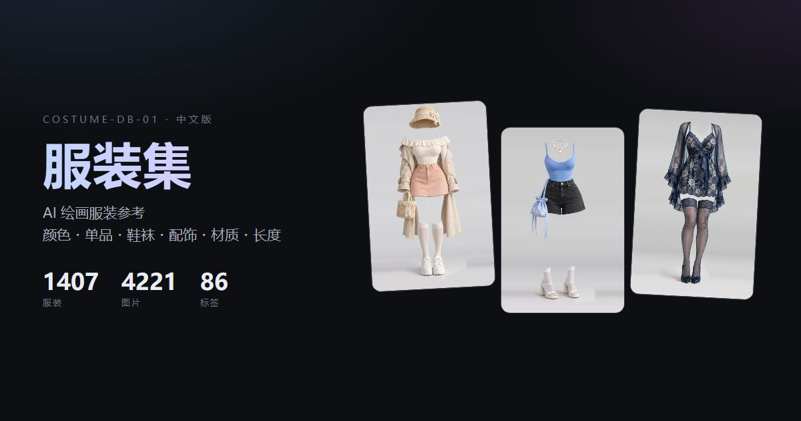

# AI Costume Gallery · 中文版

> 1407 件服装 / 4221 张参考图，8 个分类 + 86 个标签分面筛选，零依赖静态画廊。



**原始站点**：[ai-costume-gallery.pages.dev](https://ai-costume-gallery.pages.dev/)
**原作者**：ギア（[@giaaibusi](https://x.com/giaaibusi)）

---

## ⚠️ 关于素材版权（请先读）

本仓库**只包含代码与元数据，不包含任何图片**。

- 图片著作权归原作者 **ギア** 所有，原站条款**禁止再分发、转载、转售图片文件本身**
- 允许拿图做作品、商用创作、编辑与参考
- 本仓库不构成对原作品的任何授权。详见 [NOTICE.md](NOTICE.md)

图片需要你自己运行 `scripts/download.py` 从原始站点获取，供个人参考使用。

---

## 这是什么

原站是一套面向 AI 绘画 / 服装设计的服装参考图库，元数据为日文分类 + 英文关键词，不提供批量下载。本项目做了三件事：

1. **完整汉化** —— 8 个分类 + 86 个标签全部译为中文（标签另附日文名，英文原文保留在 tooltip）
2. **可用的前端** —— 零依赖单文件画廊，数据内嵌，**双击 `index.html` 就能看**（不需要起服务器）
3. **可复用的数据** —— 中文记录、元数据、英日⇄中对照表全部导出为 JSON / CSV

## 功能

- **分类 Tab**：8 个分类，带条目计数
- **标签分面筛选**：86 个标签按语义分 6 组 —— 颜色(22) / 单品(21) / 鞋袜(9) / 配饰(14) / 材质・图案(17) / 长度(3)，多选为 AND 逻辑，每枚标签带命中数
- **排序**：分类 → 编号（默认）/ 编号 / 标签数
- **搜索**：编号、分类、标签，中文 / 日文 / 英文原文三向命中
- **灯箱**：缩略图 → 中图渐进加载，`←` `→` 前后切换，`Esc` 关闭，触摸可滑动；点击标签可直接追加筛选
- **双主题**：浅色 / 深色，localStorage 记忆，首帧前套用不闪白
- **双语**：日本語 / 中文可实时切换
- **英文原文保留**：所有标签的 `title` 为原始英文关键词，方便复制做 AI 提示词

## 数据规模

| 分类 | 编号前缀 | 数量 |
|---|---|---|
| 春 | SPR | 215 |
| 夏 | SUM | 254 |
| 秋 | AUT | 244 |
| 冬 | WIN | 253 |
| 内衣（ランジェリー） | LNG | 199 |
| 性感（セクシー） | SXY | 140 |
| 泳装（水着） | SWM | 54 |
| 派对（パーティ） | PTY | 48 |
| **合计** | | **1407** |

每件服装提供三档图：缩略图 360×540 webp / 中图 1366×2048 webp / 原图 1366×2048 png。
每件平均 8.5 个标签。

## 快速开始

```bash
git clone https://github.com/Brilliant666/ai-costume-gallery-cn.git
cd ai-costume-gallery-cn

# 1. 从原始站点下载素材（断点续传，已存在自动跳过）
python scripts/download.py thumb 16    # 缩略图 360×540 webp，约 10 MB
python scripts/download.py img 14      # 中图   1366×2048 webp，约 114 MB
python scripts/download.py png 14      # 原图   1366×2048 png，约 1.33 GB（可选）

# 2. 直接打开 index.html 即可（无需服务器）
```

只下 `thumb` + `img` 就够日常浏览，共约 124 MB；`png` 是无损原图，按需再下。

## 目录结构

```
.
├── index.html              # 单页画廊（数据内嵌，file:// 可直开）
├── robots.txt / sitemap.xml / 404.html
├── og-cover.jpg            # 1200×630 社交分享封面
├── manifest.json           # 全量清单（含原始 URL 与本地路径）
├── manifest.csv            # 同上，Excel 可直接打开
├── data/
│   ├── costume.json        # 原始日文数据（未改动，1407 条）
│   ├── costume-zh.json     # 中文数据（含英/日/中三语标签）
│   ├── meta.json           # 分类与标签分组元数据
│   └── translations.csv    # 英→日→中对照表（94 条）
├── scripts/
│   ├── extract.py          # 从原站存档解析内嵌数据
│   ├── manifest.py         # 生成清单
│   ├── download.py         # 并发下载器（三档、断点续传）
│   ├── translations.py     # 日→中 / 英→中 / 英→日 词典
│   ├── build_gallery.py    # 构建 index.html + data/ + SEO 文件
│   ├── build_dist.sh       # 生成部署目录 dist/
│   └── verify.py           # 校验三档文件完整性
├── thumbs/                 # 缩略图（gitignored）
├── img/                    # 中图（gitignored）
├── png/                    # 原图（gitignored）
└── raw/                    # 原站存档（gitignored，不随仓库分发）
```

## 构建

```bash
# 重建 index.html 与 data/
SITE_URL=https://your-domain.com python scripts/build_gallery.py

# 生成部署目录
bash scripts/build_dist.sh               # 仅站点文件
bash scripts/build_dist.sh --with-images # 含图片
```

`SITE_URL` 决定 `canonical`、`og:url`、`sitemap.xml` 里的绝对地址，**部署前务必设置**，否则会指向占位域名 `example.com`。

## 部署

纯静态站点，任意静态托管都行。

**Cloudflare Pages**

```bash
bash scripts/build_dist.sh
npx wrangler pages deploy dist --project-name ai-costume-gallery-cn
```

**自有 VPS + nginx**：要点如下

- 图片目录设一年强缓存（`Cache-Control: public, max-age=31536000, immutable`）
- HTML 设 `no-cache`，改版后不会看到旧页面
- 4200+ 小文件建议开 `open_file_cache`

## 标签分组

| 组 | 数量 | 示例 |
|---|---|---|
| 颜色 | 22 | black 黑 / ivory 象牙白 / navy 藏青 |
| 单品 | 21 | dress 连衣裙 / camisole 吊带衫 / corset 束身衣 |
| 鞋袜 | 9 | boots 靴子 / pumps 单鞋 / tights 连裤袜 |
| 配饰 | 14 | bag 包 / choker 颈链 / beret 贝雷帽 |
| 材质・图案 | 17 | knit 针织 / lace 蕾丝 / polka-dot 波点 |
| 长度 | 3 | mini 迷你 / midi 中长 / maxi 长款 |

## 数据字段

`data/costume-zh.json` 每条：

| 字段 | 说明 | 示例 |
|---|---|---|
| `id` | 唯一标识 | `SPR-0001` |
| `分类` / `分类_zh` | 日文 / 中文分类名 | 春 / 春 |
| `标签` | 原始英文关键词数组 | `["ivory","frill","knit",…]` |
| `标签_zh` / `标签_ja` | 中文 / 日文标签数组 | `["象牙白","荷叶边","针织",…]` |
| `缩略图` / `中图` / `原图` | 相对路径 | `thumbs/…webp` |

## 许可

| 内容 | 许可 |
|---|---|
| 代码（`scripts/`、`index.html` 中的 HTML/CSS/JS） | MIT，见 [LICENSE](LICENSE) |
| 中文译文与结构化整理（`data/`） | CC BY 4.0 |
| 图片素材 | **不在本仓库，不授予任何权利** |
| 原始日文元数据与英文关键词 | 著作权归原作者 ギア |

详见 [NOTICE.md](NOTICE.md)。

## 内容提示

素材包含成人向服装参考，部分分类（内衣 / 性感）涉及成人内容。仅供艺术创作、服装设计与前端技术学习使用。未成年人请勿访问。
